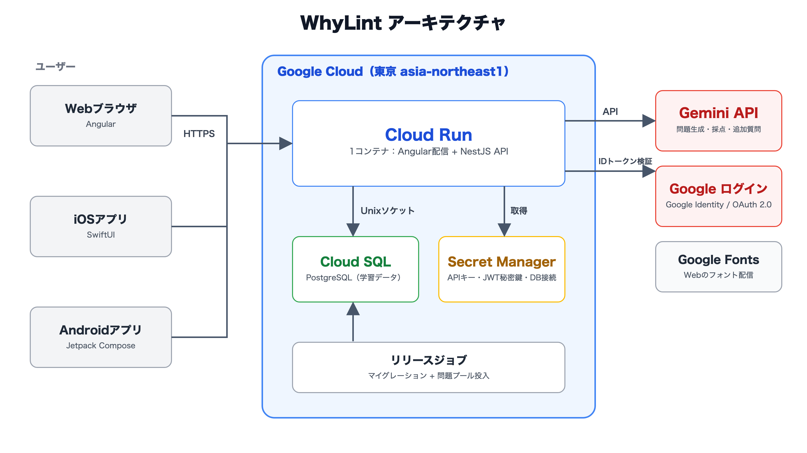
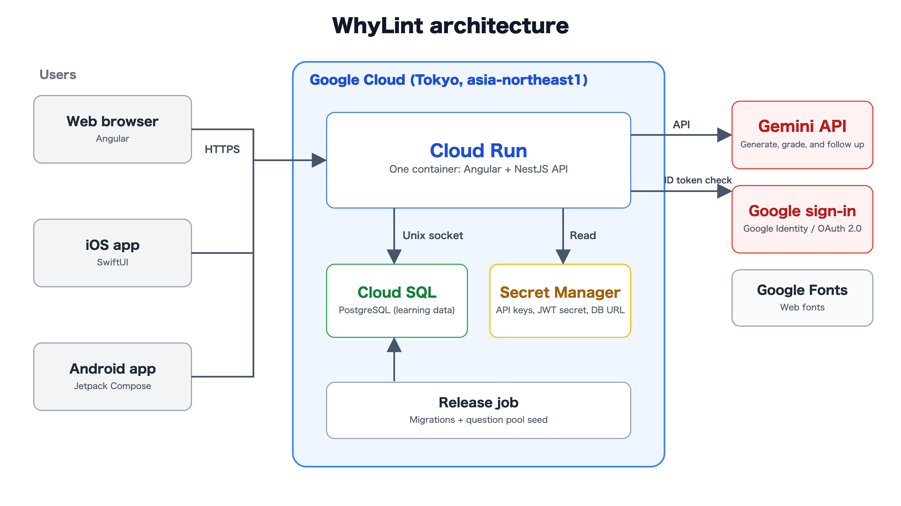

# WhyLint

**Doomscroll, but every swipe teaches you something.**

[日本語](#日本語) · [English](#english) · Live: [whylint.com](https://whylint.com)

## 日本語

WhyLint は、技術の「なぜ」「どうして」を自分の言葉で説明できるようになる学習フィードです。
スワイプするたびに数秒で答えられるクイズが出て、Gemini があなた向けの問題を作り、あなたの説明を採点します。
プログラミング言語やフレームワークに加え、JWT、HTTP、ネットワーク、マイクロサービスなどの共通概念も扱います。
GDGoC Japan DevFest 2026 Hackathon の教育カテゴリ向けに開発しています。

Web（Angular）、iOS（SwiftUI）、Android（Jetpack Compose）の3つのアプリが同じAPIとアカウントを使います。

### まずはログインなしで

- 表示言語は、アクセスした国に合わせて自動で選ばれます（日本は日本語、それ以外は英語）。いつでも切り替えられます。
- 興味のある分野、言語・フレームワーク、レベルを選ぶか、スキップしてすぐ始められます。
- 最初のカードは事前生成した問題プール（179問、日英）から即座に表示されます。毎日全員共通の「今日のバグ」もあります。
- 1枚ごとにタップで答えるクイズです。4択・○×・出力予想・バグのある行をタップの4形式があり、正誤と一言解説がすぐに表示されます。
- 3問答えると、ログインの案内が表示されます。ログイン前に答えた問題（最大200件）は、ログイン時にアカウントへ引き継がれます。

### ログインすると

ログインは Google アカウント、またはメールアドレス・ユーザー名とパスワードで行えます。

- **Geminiがあなた専用の問題を作成**: 興味・レベル・苦手な分野をもとに5問ずつ作り、各カードに出題理由を表示します。
  少なくとも1問は共通概念の問題です。次のバッチはカードがなくなる前に準備されます。
  Gemini が混み合っているときは、問題プールで学習を続けられます。
- **難易度の自動調整**: 直近6問で5問正解すると上がり、2問以下なら下がります。
- **なぜ？を説明する**: 自分の言葉で説明すると、Gemini が0〜10点で採点し、改善点を返します。8点以上で合格です。
- **まだモヤモヤ？**: 問題に沿って Gemini に追加質問できます（1問につき1日5回まで）。
- **復習**: 間違えた問題は数枚後にもう一度出題され、その後も正解するまで毎朝9時（日本時間）にフィードへ戻ってきます。
  同じ考え方の問題が続かないよう、問題ごとの概念（concept）で重複を避けます。
- **進捗**: XP、レベル、連続日数、今日の目標（5問）、コンボ、分野ごとの理解度レーダー、10種類の実績、週間ランキング。
  初回に正解すると +5 XP、説明で合格すると +15 XP（1問あたり最大20 XP）。レベルは「1 + XP ÷ 100」です。
  日付・連続日数・週間ランキング（月曜開始）は日本時間で計算します。
- 進捗と設定はアカウントに保存され、Web・iOS・Android のどれからでも続けられます。

### 共有して学ぶ

- 問題と参考解説を投稿できます。Gemini が内容を確認し、必要なら解説を修正してから公開します。
  承認された問題は投稿者名つきで他のユーザーのフィードに表示されます。タップクイズの選択肢も付けられます。
- いいね、保存、共有リンク、コメント（コメント・説明・質問・訂正、1階層の返信、「参考になった」）に対応します。
- 採点後に「自分の説明を共有」で文章を見直し、「説明を公開」で問題のコメント欄と公開プロフィールに公開できます。
- 投稿者名から公開プロフィールを開き、公開した質問・説明と「参考になった」の数を確認できます。
- カードには、用意された公式ドキュメントへの「参考資料」リンクを表示します。

### 安全とアカウント

- 問題やコメントを通報できます（スパム、嫌がらせ、不適切な内容など）。通報したコメントは自分には表示されなくなります。
- ユーザーをブロックすると、その人の問題・コメント・プロフィールが表示されなくなります。
- 通報は管理者だけが使える `/admin` で確認・対応します（`ADMIN_USER_IDS` で許可）。
- 設定から退会できます。学習データは削除され、公開した問題は名前なしで残ります。
- 利用規約（`/terms`）とプライバシーポリシー（`/privacy`）をアプリ内で公開しています。
- 表示設定: 日本語/英語、ダーク/ライト、文字サイズ。

採点用の回答、AIフィードバック、点数、復習一覧は本人だけが見られる学習情報です。
公開プロフィールには表示名・画像と、自分で公開した投稿・集計だけを表示します。

### 構成とGoogle技術



- **Cloud Run（東京）**: 1つのコンテナで Angular の画面と NestJS の API を同じオリジンから配信します。
- **Cloud SQL（PostgreSQL）**: 学習データを保存します。リリースジョブがマイグレーションと問題プールの投入を行います。
- **Gemini API**: 問題の生成、説明の採点、追加質問への回答、投稿された問題の確認。
- **Google ログイン**: Web（Google Identity Services）、iOS（Google Sign-In SDK）、Android（Credential Manager）。サーバーでIDトークンを検証します。
- 初回の言語判定には同梱の [DB-IP Country Lite](backend/data/README.md)（CC BY 4.0）を使い、外部への問い合わせは行いません。

技術スタック: Angular、NestJS、PostgreSQL、TypeORM、SwiftUI、Jetpack Compose。
デプロイ手順と環境変数は [docs/deployment.md](docs/deployment.md)、学習エンジンの仕様は [specs.md](specs.md)、
ネイティブアプリは [native/README.md](native/README.md) を参照してください。

### ローカル起動

Node.js 24.15以降、npm、PostgreSQLを使用します。環境設定とマイグレーションは
[backend/README.md](backend/README.md) を参照してください。

バックエンド用のターミナルで実行します。

```sh
cd backend
npm ci
npm run migration:run
npm run start:dev
```

フロントエンド用の別ターミナルで実行します。

```sh
cd frontend
npm ci
npm run start:auth
```

ブラウザは http://localhost:4200、APIは http://localhost:3000/api/v1 です。
Gemini を使う機能には、サーバー側の `GEMINI_API_KEY` と `GEMINI_MODEL` が必要です。
問題プールとタップクイズの採点は Gemini なしでも動きます。実際の認証情報はローカル環境で管理してください。

### テスト

```sh
npm run build --prefix backend
npm test --prefix backend -- --runInBand
npm run build --prefix frontend
npm test --prefix frontend -- --watch=false
npm run typecheck --prefix e2e
npm run test:backend --prefix e2e
npm test --prefix e2e
```

自動テストでは Google と Gemini の応答をテスト用フィクスチャに置き換え、実際のバックエンドと一時的な PostgreSQL を使います。
詳しくは [e2e/README.md](e2e/README.md) を参照してください。

## English

WhyLint is a scrolling learning feed that trains you to explain **why and how technology works**.
Every swipe is a quiz you answer in seconds, Gemini writes questions for you, and Gemini grades the
explanations you write. It covers programming languages and frameworks plus shared concepts such as
JWT, HTTP, networking, and microservices. Built for the education category of the GDGoC Japan DevFest 2026 Hackathon.

The web app (Angular), iOS app (SwiftUI), and Android app (Jetpack Compose) share one API and one account.

### Try it without an account

- The first display language comes from your country (Japanese in Japan, English elsewhere). Switch it any time.
- Pick interests, languages and frameworks, and a starting level, or skip setup and start right away.
- The first cards come instantly from a pre-generated pool of 179 questions in Japanese and English,
  plus a shared Bug of the Day.
- Every card is a tap quiz: multiple choice, true/false, predict the output, or tap the buggy line.
  The right answer and a one-line explanation appear immediately.
- After three answers, the feed invites you to sign in. Up to 200 answers you gave before signing in carry into your account.

### What signing in adds

Sign in with Google, or create an account with an email address or username and a password.

- **Gemini writes your feed**: batches of five questions built from your interests, level, and weak topics,
  each card labelled with why it was picked. At least one question covers a general concept. The next batch
  is prepared before you run out. If Gemini is busy, the question pool keeps the feed going.
- **Adaptive difficulty**: five right out of the last six raises your level; two or fewer lowers it.
- **Explain why**: write an explanation in your own words and Gemini scores it from 0 to 10, with what to improve. 8 passes.
- **Still confused? Ask Gemini**: short follow-up questions grounded in the card (five per question per day).
- **Practice**: a missed card comes back a few cards later, then every morning at 9:00 (Japan time) until you answer it
  correctly. Questions carry a canonical concept, so the feed avoids reworded repeats.
- **Progress**: XP, level, streak, a daily goal of five questions, combo, a mastery radar by area, ten achievements,
  and a weekly leaderboard. A correct first answer earns +5 XP and a passed explanation +15 XP (at most 20 XP per question).
  Level is 1 + XP ÷ 100. Dates, streaks, and the leaderboard week (starting Monday) use Japan time.
- Progress and settings are stored in your account, so you can continue on the web, iOS, or Android.

### Learn together

- Publish a question with a reference explanation. Gemini checks it, corrects the reference when needed, and
  approved questions reach other learners' feeds with your name. You can add tap-quiz options.
- Like, save, share by link, and discuss: comments, explanations, questions, and corrections, one-level replies,
  and **Helpful** votes.
- After grading, **Share my explanation** lets you revise your text, then **Publish explanation** posts it to the
  question's discussion and your public profile.
- Open a creator's public profile from their name to see published questions, shared explanations, and Helpful counts.
- Cards show **Further reading** links to curated official documentation.

### Safety and your account

- Report a question or comment (spam, harassment, inappropriate content, and more). A comment you report is hidden for you.
- Block a learner to hide their questions, comments, and profile from you.
- Admins review reports at `/admin` (allowed accounts are set with `ADMIN_USER_IDS`).
- Delete your account from Settings. Your learning data is removed; questions you published stay without your name.
- The Terms of Service (`/terms`) and Privacy Policy (`/privacy`) are published in the app.
- Display settings: Japanese or English, dark or light, and text size.

Original answers, AI feedback, scores, and the Practice list are private to you. Public profiles show only your
display identity and the contributions you chose to publish.

### Architecture and Google technology



- **Cloud Run (Tokyo)**: one container serves the Angular app and the NestJS API from the same origin.
- **Cloud SQL (PostgreSQL)**: learning data. A release job runs migrations and loads the question pool.
- **Gemini API**: question generation, explanation grading, follow-up answers, and review of published questions.
- **Sign in with Google**: Google Identity Services on the web, the Google Sign-In SDK on iOS, and Credential Manager
  on Android. The server verifies the ID token.
- The first-language suggestion uses the bundled [DB-IP Country Lite](backend/data/README.md) data (CC BY 4.0),
  with no external lookup.

Stack: Angular, NestJS, PostgreSQL, TypeORM, SwiftUI, and Jetpack Compose. Deployment and environment variables are in
[docs/deployment.md](docs/deployment.md), the learning engine contract is in [specs.md](specs.md), and the native
apps are in [native/README.md](native/README.md).

### Run it locally

Node.js 24.15 or newer, npm, and PostgreSQL. Backend environment setup and migrations are in
[backend/README.md](backend/README.md). Use the backend and frontend commands in the Japanese section above;
the app runs at http://localhost:4200 and the API at http://localhost:3000/api/v1.

Gemini features need server-side `GEMINI_API_KEY` and `GEMINI_MODEL`. The question pool and tap grading work without
them. An unavailable AI provider returns a retryable error and never turns into a failing grade.

### Verification

```sh
npm run build --prefix backend
npm test --prefix backend -- --runInBand
npm run build --prefix frontend
npm test --prefix frontend -- --watch=false
npm run typecheck --prefix e2e
npm run test:backend --prefix e2e
npm test --prefix e2e
```

The browser suite owns port 4200 while running. Its real NestJS backend uses port 3101 and a disposable PostgreSQL
cluster. Google and Gemini calls are replaced with test fixtures. See [e2e/README.md](e2e/README.md).

[Organizer repository guidance](docs/organizer-guide.md) · [Production readiness](docs/production-readiness.md) · [MIT license](LICENSE)
